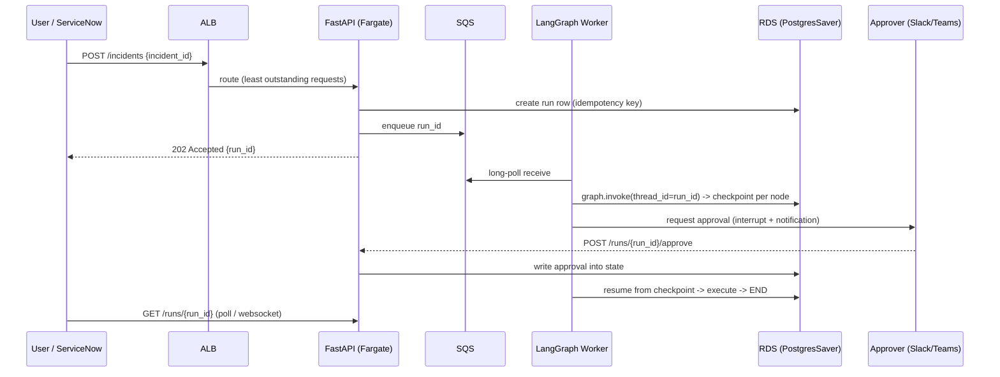

# Incident Management Automation — Interview Prep

---

## 1. Project Overview

**Project Name:** Incident Management Automation with LangGraph.

**Business Problem**
Production incidents (VM unhealthy, server unreachable, network device down,
application service failing) are raised in ServiceNow and handled manually by
on-call engineers. Every incident goes through the same manual routine —
pulling the ticket, running diagnostics, correlating logs, looking at
historical health, searching runbooks/SOPs/KB/SharePoint, chasing approval,
and finally executing the fix.

**Why the project was needed**

- To reduce Mean Time To Resolve (MTTR).
- To make triage, diagnostics and RCA consistent across engineers.
- To ground remediation in approved runbooks instead of tribal knowledge.
- To keep an auditable trail of every incident's investigation, decision, and
  action.
- To let humans focus on the *approval decision*, not on the mechanical steps.

**Existing challenges (without this system)**

- Manual pull of incidents from ServiceNow.
- Ad-hoc diagnostic commands (ping, SSH, router status) with no consistency.
- Fragmented knowledge across Runbooks / SOPs / KB / SharePoint.
- Approvals chased over chat/email → delays MTTR.
- No audit trail linking incident → diagnostics → RCA → approval → action.
- No resumability if the on-call engineer is interrupted.

**Proposed solution**
A **LangGraph multi-agent workflow** with **five specialized agents** —
Triage, Command Executor & Log Extractor, Diagnostic, RCA / Analysis, and
Remediation — chained through a typed `IncidentState` and gated by two
conditional edges (need-remediation + HITL approval). `MemorySaver` provides
checkpointing for resumability and audit.

---

## 2. Why This Solution?

**Why this architecture was chosen**
The problem is naturally a sequence of specialized steps where each step
produces findings the next step needs. That maps directly to a **stateful,
inspectable graph of agents** — which is exactly what LangGraph provides.
Splitting the flow into five agents means each has one narrow responsibility,
which makes prompts, tools, and error handling simple.

**Why traditional approaches were insufficient**

- **Plain scripts** — hard-code decisions, no shared state, no HITL pause/
  resume, no audit checkpoints.
- **Ticket-based automation (ITSM workflow only)** — no LLM reasoning, no RAG
  grounding, no dynamic tool selection per incident type.
- **A single LLM chain** — cannot pause for human approval mid-flow, cannot
  route conditionally on real system state, and mixes investigation with
  action in a way that's unsafe.
- **A single monolithic agent** — poor observability, one giant prompt, hard
  to test and iterate.

**Why Agentic AI was needed**
Incident handling requires multiple tool calls (ServiceNow, ping, SSH, router,
logs), retrieved knowledge (runbooks/SOPs via RAG), conditional decisions
(*need remediation? approved?*), and a real human in the loop. That's a
textbook agentic workload.

**Why RAG was needed**
Resolution steps must come from **approved** procedures — runbooks, SOPs,
knowledge base, SharePoint. Freeform LLM output is unsafe for production
remediation. RAG retrieves the right procedure and grounds the RCA / Analysis
agent's recommendations.

> ⚠️ **Implementation status:** RAG is part of the design; the POC file
> `Langraph.py` does **not** implement a vector store or retrieval — the
> `analysis_agent` returns a hardcoded RCA string. See §7.

---

## 3. Technology Stack

| Component | Technology | Why Used |
| :--- | :--- | :--- |
| **Multi-Agent Orchestration** | **LangGraph** (`StateGraph`, `add_node`, `add_edge`, `add_conditional_edges`) | Enables explicit workflow orchestration with stateful agent execution and conditional routing between Triage, Cmd/Log, Diagnostic, RCA, and Remediation agents. |
| **Shared State Management** | **Python `TypedDict`** (`IncidentState`) | Provides a strongly typed state object for passing incident data, diagnostic output, logs, health analysis, RCA, approval, and remediation across agents. |
| **Persistence / Checkpointing** | **LangGraph `MemorySaver`** (`langgraph.checkpoint.memory.MemorySaver`) | Persists workflow state and allows recovery or continuation during Human-in-the-Loop interruptions or tool failures. |
| **Human-in-the-Loop** | **Console `input()`** (POC) | Introduces manual approval before any remediation or operational action, keeping a human in control of every change. |
| **Incident Intake (POC)** | **Excel file** *(designed)* / Python stub `fetch_incident_from_servicenow` *(implemented)* | Source of incident details for the POC; simulates the production ServiceNow feed so the graph can be exercised end-to-end. |
| **Incident Intake (Prod)** | **ServiceNow** (planned as an MCP tool) | Standardized integration to fetch live incidents in production through a shared tool interface. |
| **Diagnostic Tools** | **ping / SSH check / switch-router status check / log extractor** *(designed, not in POC)* | Executes initial diagnostic actions per incident type and collects command output and logs into shared state. |
| **Health Analysis** | **Monitoring / historical health lookup** *(designed)* | Analyzes past and current health of the affected VM / server / network device to explain behavior before the incident. |
| **RAG Store** | **Runbooks / SOPs / Knowledge Base / SharePoint** *(designed; not in POC)* | Grounds RCA and remediation recommendations in approved procedures instead of freeform LLM output. |
| **LLM** | *Not wired in the POC*; would sit inside the Diagnostic and RCA / Analysis agents | Provides reasoning over logs, health data, and retrieved runbook chunks to produce RCA and recommended steps. |
| **Language / Runtime** | **Python 3** | Language for the LangGraph app, agents, tool wrappers, and state definitions. |

---

## 4. Architecture

```
                +------------------+
                |   User / Ticket  |
                +------------------+
                          |
                          v
        +--------------------------------------+
        |            Triage Agent              |
        |   POC: Excel  /  Prod: ServiceNow    |
        +--------------------------------------+
                          |
                          v
        +--------------------------------------+
        | Command Executor & Log Extractor     |
        |  ping / SSH / switch-router status / |
        |            log collection            |
        +--------------------------------------+
                          |
                          v
        +--------------------------------------+
        |          Diagnostic Agent            |
        |  historical + current health of the  |
        |    VM / server / network device      |
        +--------------------------------------+
                          |
                          v
        +--------------------------------------+
        |         RCA / Analysis Agent         |
        |    RAG: Runbooks / SOPs / KB /       |
        |             SharePoint               |
        +--------------------------------------+
                          |
                          v
                +---------------------+
                |  Need Remediation?  |
                +---------------------+
                    |            |
                 NO |            | YES
                    v            v
                +-------+   +--------------------------+
                |  END  |   |     Remediation Agent    |
                +-------+   |     (Human in Loop)      |
                            +--------------------------+
                                       |
                                       v
                            +----------------------+
                            |  approval == "yes"?  |
                            +----------------------+
                              |            |
                           YES|            |NO
                              v            v
                    +--------------------+  +-------+
                    | Execute Remediation|  |  END  |
                    +--------------------+  +-------+
                              |
                              v
                          +-------+
                          |  END  |
                          +-------+

              [ MemorySaver checkpointer wraps the whole graph ]
```


## 5. Complete Workflow

1. **User Input** — `graph.invoke({"incident_id": "INC1001"})`.
2. **Triage Agent** reads the incident (Excel in POC / ServiceNow in prod) and
   writes `incident_data` (short desc, severity, type, affected asset) into
   state.
3. **Command Executor & Log Extractor Agent** runs diagnostic checks selected
   by incident type — for a network incident: ping, SSH connectivity check,
   switch/router status check — and collects logs / command output into state.
4. **Diagnostic Agent** analyzes historical + current health of the affected
   asset and writes `health_analysis` into state.
5. **RCA / Analysis Agent** retrieves troubleshooting and resolution steps via
   RAG over Runbooks / SOPs / KB / SharePoint, writes `rca` +
   `recommended_steps` into state.
6. **Decision 1 — `need_remediation`** (conditional edge):
   - If remediation is not required → `END`.
   - Else → route to the Remediation Agent.
7. **Remediation Agent (HITL)** presents the incident, RCA and recommended
   steps to the human and asks for approval.
8. **Decision 2 — `approval_router`** (conditional edge):
   - `state["approval"] == "yes"` → execute recommended steps, write
     `remediation` into state.
   - Otherwise → `END` without any change.
9. **End** — final state is checkpointed via `MemorySaver` (audit trail).

**Routing / decision points:**
- Severity / need-remediation gate after RCA.
- HITL approval gate inside Remediation.
- **Failure short-circuit** after every node — if `state["status"] == "failed"`,
  the graph routes straight to the `failure` node and ends.
- Retries happen *inside* a node (tool/LLM level), not as graph loops, so
  there is no cyclic edge that could run forever.

---

## 5b. Error Handling, Retries & Termination

**Config knobs (top of `Langraph.py`):**

| Constant | Value | Purpose |
| :--- | :--- | :--- |
| `MAX_RETRIES` | 3 | Attempts per tool / LLM call |
| `RETRY_BASE_DELAY` / `RETRY_MAX_DELAY` | 1.0s / 8.0s | Exponential backoff with jitter |
| `TOOL_TIMEOUT` | 15s | Hard timeout per MCP / diagnostic tool call |
| `LLM_TIMEOUT` | 45s | Hard timeout per LLM call |
| `HITL_TIMEOUT` | 120s | Max wait for human approval, then auto-deny |
| `MAX_TOOL_CALLS` | 12 | Hard tool-call budget for the whole run |
| `RECURSION_LIMIT` | 25 | LangGraph super-step limit (runaway-loop guard) |

**Mechanisms:**

1. **`@resilient(timeout, retries)`** — wraps every tool and LLM call. Submits
   the call to a thread pool and enforces a hard timeout, retries with
   exponential backoff + jitter, and raises `NodeFailure` when attempts are
   exhausted. `max_retries=0` is set on the LLM client so retries are owned in
   one place (no hidden retry multiplication).
2. **`@guarded_node(name)`** — wraps every agent. Catches `NodeFailure`,
   `BudgetExceeded`, `KeyError`, `ValueError`; writes `status="failed"`,
   `failed_node`, and an `errors[]` entry into state instead of crashing the
   graph. If the run is already failed/aborted the node is a no-op.
3. **Tool-call budget** — `charge_tool_call()` increments `state["tool_calls"]`
   and raises `BudgetExceeded` past `MAX_TOOL_CALLS`. This is the "max tool
   call limit" that stops cost/loop blowups.
4. **Termination conditions** — the run ends when: all nodes complete
   (`status="completed"`), remediation is not needed, the human denies,
   HITL times out (`status="aborted"`, fail-safe = no change), a node fails
   (`status="failed"` → `failure` node), the tool budget is exhausted, or
   LangGraph's `recursion_limit` trips.
5. **Failure handler node** — terminal node that marks remediation as
   `"NOT EXECUTED - escalated to human on-call"` so a failed run is explicit
   and auditable rather than silently empty.
6. **Checkpoint fallback** — `graph.invoke` is wrapped in try/except; on an
   unexpected abort the last good checkpoint is read with
   `graph.get_state(config).values`.

**Validation / fail-fast:** the ServiceNow tool validates required fields
(`severity`, `asset`) and `call_llm` rejects empty LLM responses — both are
retryable errors rather than bad data flowing downstream.

**Fail-safe default:** every ambiguous outcome (timeout, failure, no answer)
resolves to *do not execute the change*.

---

## 6. Agents

| Agent | Responsibility | Input | Output | Tools Used |
| :--- | :--- | :--- | :--- | :--- |
| **Triage Agent** | Retrieves the incident and normalizes its details into shared state. Reads from Excel in the POC and from ServiceNow in production. | `incident_id` | `incident_data` (short description, severity, incident type, affected asset) | **Excel reader** (POC) / **ServiceNow MCP** (prod) |
| **Command Executor & Log Extractor** | Runs initial diagnostic checks selected by incident type (ping, SSH check, switch/router status check for network incidents) and collects relevant logs and command output. | `incident_data` | `diagnostic_output`, `logs` | **ping**, **SSH check**, **switch/router status check**, **log extractor** |
| **Diagnostic Agent** | Analyzes historical and current health of the affected VM / server / network device to establish baseline behavior and detect deviations before the incident. | `incident_data`, `diagnostic_output`, `logs` | `health_analysis` | **Monitoring / historical health data lookup** |
| **RCA / Analysis Agent** | Retrieves troubleshooting and resolution steps from approved sources via RAG and produces a grounded RCA plus recommended remediation steps. | Full accumulated state | `rca`, `recommended_steps` | **RAG** over Runbooks / SOPs / Knowledge Base / SharePoint |
| **Remediation Agent** | Holds the Human-in-the-Loop approval gate and executes the recommended remediation only when the human approves. Otherwise the workflow stops without any change. | `rca`, `recommended_steps` | `approval`, `remediation` | **HITL prompt** + **change / execution tool** |

*(POC parity: the 5 agents map to `intake_agent` → Triage,
`analysis_agent` → RCA, and `approval_agent` + `remediation_agent` → the
Remediation Agent's HITL + execute steps. Cmd/Log and Diagnostic agents are
part of the design but not present in the POC file.)*

---

## 7. RAG Implementation


**Ingestion**
- Sources: Runbooks, SOPs, Knowledge Base articles, SharePoint pages.
- Loaders per source type (PDF, DOCX, HTML, SharePoint API).
- Metadata captured: source, doc id, section, incident type, asset type,
  last-updated timestamp.

**Chunking**
- Text-splitter per doc type (recursive character or section-aware for
  runbooks).
- Typical target: 500–1000 tokens with 10–15% overlap.
- Keep procedure steps in the same chunk when possible.

**Embeddings**
- A production-grade embedding model (e.g., OpenAI `text-embedding-3-*` or an
  in-house model).
- Store embeddings alongside metadata.

**Vector Database**
- Any managed or self-hosted store (e.g., PGVector, FAISS, Pinecone,
  Elastic/OpenSearch).
- Not chosen in the POC.

**Retrieval**
- Query built from `incident_data` + `health_analysis` (asset type, incident
  type, symptoms, key log lines).
- Top-k semantic search filtered by metadata (e.g., matching asset type or
  service).

**Reranking**
- Cross-encoder reranker to lift the most relevant runbook chunk to the top
  before the LLM composes the RCA.
- Optional in POC; recommended in production.

**Hybrid retrieval (optional)**
- BM25 + dense retrieval to catch exact runbook titles and command-name
  matches that pure dense retrieval can miss.

**Retrieval architecture (target):**

```
incident_data + health_analysis + key log lines
        │
        ▼
     Query builder
        │
        ▼
 ┌───────────────┐   ┌───────────────┐
 │ BM25 (hybrid) │ + │ Dense vector  │
 └───────────────┘   └───────────────┘
        │                    │
        └─────────┬──────────┘
                  ▼
             Fusion / Rerank
                  ▼
        Top runbook / SOP chunks
                  ▼
     RCA / Analysis Agent (LLM)
                  ▼
     rca + recommended_steps in state
```

---

## 8. LangGraph Implementation

**State**
- `IncidentState` is a `TypedDict` — the single object passed between nodes.
- **POC fields:** `incident_id`, `incident_data`, `analysis`, `approval`,
  `remediation`.
- **Extended (real design):** adds `diagnostic_output`, `logs`,
  `health_analysis`, `rca`, `recommended_steps`.
- Each node returns a **partial dict**, which LangGraph merges into state so
  all downstream nodes see prior findings.

**Nodes**
- POC: `orchestrator`, `intake_agent`, `analysis_agent`, `approval_agent`,
  `remediation_agent`.
- Real design: `Triage`, `Command Executor & Log Extractor`, `Diagnostic`,
  `RCA / Analysis`, `Remediation`.

**Edges**
- Static: entry → Triage → Cmd/Log → Diagnostic → RCA.
- POC static edges: `orchestrator → intake → analysis`, `remediation → END`.

**Conditional Routing**
- **`need_remediation`** — evaluated after RCA.
  - POC: reads `state["incident_data"]["severity"]`; `"High"` →
    `"approval"`, else `"end"`.
  - Real design: routes to Remediation when the RCA says a change is
    required, otherwise to `END`.
- **`approval_router`** — evaluated inside Remediation.
  - `state["approval"] == "yes"` → `"remediation"` (execute), else
    `"end"`.

**Checkpointer**
- `memory = MemorySaver()` and
  `graph = builder.compile(checkpointer=memory)`.
- Purpose: durable state across HITL pause and any interruption; supports
  resumability from the last checkpoint.
- **Production note:** `MemorySaver` is in-process; for production swap for a
  persistent checkpointer (e.g., SQLite/Redis/Postgres) — *not* done in the
  POC.

**Human-in-the-Loop**
- Implemented inside the Remediation Agent (`approval_agent` in the POC).
- POC uses `input("Approve remediation? (yes/no): ")`.
- Real design: a UI / Slack / Teams approval that shows the RCA and
  recommended steps to the human before they answer.

**Retries / failure handling**
- **Implemented.** Tool and LLM calls are wrapped in `@resilient(timeout,
  retries)` — hard timeout + bounded exponential backoff with jitter
  (`MAX_RETRIES = 3`).
- Agents are wrapped in `@guarded_node(name)` — failures become
  `status="failed"` + `failed_node` + `errors[]` in state, never an exception
  that kills the graph.
- Each linear edge is a conditional edge (`continue_or_fail`) that routes to
  the terminal `failure` node once `status == "failed"`.
- `MAX_TOOL_CALLS = 12` caps total tool invocations; `RECURSION_LIMIT = 25` is
  passed in `config` to terminate runaway graph loops.
- HITL has `HITL_TIMEOUT = 120s`; on timeout the run is `aborted` and nothing
  is executed (fail-safe).
- Because state is checkpointed per node, a failed run can also be resumed
  from the last checkpoint without re-running earlier agents.
- **Alternative:** LangGraph also offers node-level `RetryPolicy` via
  `builder.add_node(name, fn, retry=RetryPolicy(max_attempts=3))` — the custom
  decorator was used here because it also gives timeouts and budget counting.

---

## 9. Tools / MCP

| Tool | Purpose | Input | Output |
| :--- | :--- | :--- | :--- |
| **Excel reader** (POC) / **ServiceNow** (prod) | Fetches the incident record so the Triage Agent can normalize details into shared state. | `incident_id` | `incident_data` (short description, severity, incident type, affected asset) |
| **Ping** | Verifies basic network reachability of the affected asset during initial diagnostics. | Target host / IP | Reachability result |
| **SSH connectivity check** | Confirms the server can be reached and a session established for further diagnostics. | Host + credentials / session | Session status |
| **Switch / router status check** | Verifies the operational state of the network device involved in the incident. | Device identifier | Device status |
| **Log extractor** | Collects relevant logs from the affected asset for correlation and RCA. | Asset + time range | Log snippets |
| **Monitoring / historical health lookup** | Provides past and current health signals of the affected asset for the Diagnostic Agent. | Asset id | Health analysis |
| **RAG store** (Runbooks / SOPs / KB / SharePoint) | Retrieves grounded troubleshooting and resolution steps for the RCA / Analysis Agent. | Incident + health context | Grounded RCA + recommended steps |
| **HITL prompt** | Captures the human's go / no-go decision before any change action is executed. | Prompt (with full context) | `"yes"` / `"no"` |
| **Change / execution tool** | Executes the approved remediation steps against the target system. | Recommended steps | Execution result |
| **`MemorySaver`** (LangGraph checkpointer) | Persists workflow state after every node so the graph is resumable and auditable. | State snapshot | Persisted checkpoint |

**MCP status**
- The POC labels `fetch_incident_from_servicenow(incident_id)` as an "MCP
  TOOL" in a comment, but it is a **plain Python stub** — no MCP server is
  running, no MCP client is used. Same for `run_diagnostics(asset)`.
- **Design intent:** ServiceNow (and diagnostic tools like ping/SSH/router
  status and the log extractor) would be exposed as **MCP tools** so agents
  can call them through a standard interface.
- **MCP Resources / Prompts:** not implemented in the POC.

**Planned MCP servers & the tools they expose**

| MCP Server | Tools exposed | Used by agent | Guardrails applied |
| :--- | :--- | :--- | :--- |
| **ServiceNow MCP** | `get_incident`, `update_incident`, `add_work_note` | Triage | `TOOL_TIMEOUT` 15s, 3 retries, field validation |
| **Infra / Diagnostics MCP** | `ping`, `ssh_check`, `router_status`, `fetch_logs` | Command Executor & Log Extractor | `TOOL_TIMEOUT`, retries, read-only credentials |
| **Monitoring MCP** | `get_health_history`, `get_current_metrics` | Diagnostic | `TOOL_TIMEOUT`, retries |
| **Knowledge / RAG MCP** | `search_runbooks` over Runbooks / SOPs / KB / SharePoint | RCA / Analysis | timeout; empty result → surface at HITL, never auto-execute |
| **Change / Execution MCP** | `run_remediation`, `restart_service` | Remediation (post-approval only) | 2 retries only, idempotency key, HITL gate before any call |
| **Approval MCP** (prod) | `request_approval` via Slack / Teams / UI | Remediation (HITL) | `HITL_TIMEOUT` 120s → auto-deny |

All MCP calls go through `charge_tool_call()`, so the `MAX_TOOL_CALLS = 12`
budget applies across every server in the run.

---

## 10. Business Value

- **Reduced manual effort** — engineers no longer manually pull incidents,
  run diagnostic commands, chase runbooks, or copy-paste RCA steps.
- **Faster processing / lower MTTR** — Triage → Cmd/Log → Diagnostic → RCA
  runs automatically with shared state; the human's only job is the approval
  decision.
- **Better accuracy** — RCA is grounded via RAG in approved Runbooks / SOPs /
  KB / SharePoint instead of freeform LLM output or tribal knowledge.
- **Operational efficiency** — same 5-agent path for every incident, so
  handling scales with volume, not with headcount.
- **Standardization** — one canonical flow across all on-call engineers.
- **Governance & auditability** — every step (incident, diagnostics, logs,
  health, RCA, approval, remediation) is captured in `IncidentState` and
  checkpointed by `MemorySaver`, giving a complete audit trail.
- **Safety** — investigation agents are read-only; only the Remediation Agent
  can change anything, and only after both the need-remediation gate and the
  HITL approval gate pass.

---

## 11. Interview Explanation

### A) 30-second version
> I built a five-agent LangGraph workflow for production incidents: a Triage
> Agent pulls the ticket (Excel in POC, ServiceNow in prod); a Command
> Executor & Log Extractor Agent runs ping/SSH/router checks and collects
> logs; a Diagnostic Agent analyzes historical and current health; an RCA /
> Analysis Agent uses RAG over runbooks/SOPs/KB/SharePoint; and a Remediation
> Agent executes only after a Human-in-the-Loop approval. State is a typed
> `IncidentState` shared across agents; `MemorySaver` gives resumability.

### B) 1-minute version
> The workflow starts with a **Triage Agent** that fetches incident details —
> Excel in POC, ServiceNow in prod. A **Command Executor & Log Extractor
> Agent** runs initial diagnostic checks per incident type — for network
> incidents that's ping, SSH connectivity, and switch/router status — and
> collects logs. A **Diagnostic Agent** looks at historical and current
> health of the affected VM/server/network device. An **RCA / Analysis
> Agent** does RAG over runbooks / SOPs / KB / SharePoint so the RCA and
> recommended steps are grounded in approved procedures. A conditional edge
> `need_remediation` decides whether remediation is needed; if yes, the
> **Remediation Agent** asks a human for approval. Only on `"yes"` does it
> execute the recommended steps; otherwise the workflow ends. Everything
> runs on a LangGraph `StateGraph` with `MemorySaver`, so state is durable
> and the graph is resumable — important because it pauses at HITL.

### C) 2-minute version
> The problem is that production incidents are handled manually today.
> Engineers pull the ticket from ServiceNow, run diagnostic commands, look at
> monitoring, search runbooks or SharePoint for the fix, chase approvals,
> and execute remediation by hand. It's slow, inconsistent, and unauditable.
>
> I built an Agentic AI workflow in LangGraph with five agents.
>
> **Triage Agent** fetches incident details — Excel in the POC, ServiceNow
> (as an MCP tool) in production — and writes them into a typed
> `IncidentState`.
>
> **Command Executor & Log Extractor Agent** runs initial diagnostics based
> on incident type. For a network incident, that's ping, SSH connectivity,
> switch/router status. It also collects logs and command output.
>
> **Diagnostic Agent** analyzes historical and current health of the affected
> asset using past operational data.
>
> **RCA / Analysis Agent** is the RAG step — it retrieves troubleshooting
> steps from runbooks, SOPs, knowledge base, and SharePoint. This grounds
> RCA in approved procedures rather than freeform LLM output.
>
> **Remediation Agent** is the only agent that changes anything. It has a
> Human-in-the-Loop approval — if the human says `"yes"`, the recommended
> steps execute; if not, the workflow stops.
>
> Two conditional edges enforce safety: a **`need_remediation`** gate after
> RCA, and an **`approval_router`** gate inside Remediation. Investigation
> agents are read-only; only Remediation can act. The graph is compiled
> with `MemorySaver`, so state is checkpointed and the flow can resume —
> important because it pauses at HITL.
>
> The result: end-to-end automation, RAG-grounded RCA, HITL safety, and a
> full audit trail in state. To be transparent: the POC is a LangGraph
> scaffold — the LLM, RAG, real MCP server, and diagnostic tool wiring are
> the next production steps.

---

## 12. Interview Questions (15)

### 1. Explain the architecture end-to-end.
- **Short:** Triage → Cmd/Log → Diagnostic → RCA (RAG) → need-remediation
  gate → Remediation (HITL) → approval gate → Execute. Shared
  `IncidentState`, `MemorySaver` checkpointer.
- **Detailed:** LangGraph `StateGraph(IncidentState)`. The Triage Agent
  reads Excel/ServiceNow; Cmd/Log runs diagnostic checks per incident type
  and collects logs; Diagnostic pulls historical + current health; RCA /
  Analysis uses RAG over runbooks/SOPs/KB/SharePoint to produce grounded
  RCA + recommended steps; a `need_remediation` conditional edge either
  ends the flow or routes to the Remediation Agent; inside Remediation a
  HITL approval gate (`approval_router`) either executes or ends.
  `MemorySaver` checkpoints state after each node for resumability and
  audit.

### 2. Why LangGraph and not LangChain or a plain script?
- **Short:** Because I need typed shared state, conditional routing, HITL
  pause/resume, and checkpointing — LangGraph gives all of that natively.
- **Detailed:** LangChain chains are linear and stateless in the sense the
  project needs. A plain script would hand-roll `if/else`, state passing,
  HITL blocking, and persistence. LangGraph's `StateGraph`,
  `add_conditional_edges`, and `MemorySaver` express exactly what the
  workflow needs, are inspectable, and let each agent stay small and
  testable.

### 3. Why five agents instead of one?
- **Short:** Single responsibility — each agent has one narrow job with its
  own prompt, tools, and errors.
- **Detailed:** Triage is intake, Cmd/Log is diagnostics, Diagnostic is
  health analysis, RCA is retrieval + reasoning, Remediation is HITL +
  execute. Small agents = simpler prompts, easier tool wiring, easier
  observability, and safer separation between investigation (read-only)
  and change actions.

### 4. How does state flow between agents?
- **Short:** A shared `IncidentState` `TypedDict`; each node returns a
  partial dict that LangGraph merges.
- **Detailed:** Triage writes `incident_data`; Cmd/Log writes
  `diagnostic_output` + `logs`; Diagnostic writes `health_analysis`; RCA
  writes `rca` + `recommended_steps`; Remediation writes `approval` and
  `remediation`. Every downstream agent reads the full accumulated state,
  so the HITL step sees complete context.

### 5. How does conditional routing work here?
- **Short:** Two conditional edges — `need_remediation` after RCA and
  `approval_router` after HITL.
- **Detailed:** `need_remediation` inspects state (in the POC,
  `incident_data["severity"]`) and returns `"approval"` or `"end"`.
  `approval_router` inspects `state["approval"]` and returns
  `"remediation"` or `"end"`. Both are wired via
  `add_conditional_edges(node, router_fn, {label: target, ...})`.

### 6. Where is RAG used and how would you implement it?
- **Short:** In the RCA / Analysis Agent, over Runbooks/SOPs/KB/SharePoint.
  The POC does not implement it.
- **Detailed:** Ingest per-source loaders → section-aware chunking →
  embeddings → vector store (PGVector/FAISS/Pinecone/OpenSearch) →
  hybrid retrieval (BM25 + dense) filtered by asset/incident type →
  cross-encoder rerank → LLM composes RCA + recommended_steps grounded in
  the top runbook chunks.

### 7. What tools does the Command Executor & Log Extractor Agent use?
- **Short:** ping, SSH connectivity check, switch/router status check, log
  extractor.
- **Detailed:** Tools are chosen based on incident type. Network-type
  incidents run reachability (ping), device status, and SSH validation;
  server-type incidents run SSH + local log extraction. Outputs are written
  as `diagnostic_output` and `logs` in state.

### 8. Where is Human-in-the-Loop and why is it there?
- **Short:** Inside the Remediation Agent, right before executing any
  change.
- **Detailed:** HITL sits inside Remediation because that's the only place
  a change can happen. The human sees the full state (incident, logs,
  health, RCA, recommended steps) before deciding. `"yes"` → execute,
  anything else → `END`. This keeps all read-only investigation agents
  fully automated and puts the safety gate exactly where risk exists.

### 9. What is MCP in this project?
- **Short:** ServiceNow (and the diagnostic tools) are exposed as MCP
  tools; the POC uses a stub function labeled as an MCP tool.
- **Detailed:** Six MCP servers are planned — **ServiceNow** (`get_incident`,
  `update_incident`, `add_work_note`), **Infra/Diagnostics** (`ping`,
  `ssh_check`, `router_status`, `fetch_logs`), **Monitoring**
  (`get_health_history`, `get_current_metrics`), **Knowledge/RAG**
  (`search_runbooks`), **Change/Execution** (`run_remediation`,
  `restart_service`), and **Approval** (`request_approval` via Slack/Teams).
  Every call is wrapped with a timeout + retries and counted against the
  `MAX_TOOL_CALLS` budget. The POC (`Langraph.py`) has Python stubs
  (`fetch_incident_from_servicenow`, `run_diagnostics`) labeled "MCP TOOL" —
  no MCP server is actually running.

### 10. How does `MemorySaver` work and why is it used?
- **Short:** In-memory checkpointer attached at compile time
  (`builder.compile(checkpointer=memory)`). Gives resumability + audit.
- **Detailed:** After every node executes, LangGraph persists the merged
  state as a checkpoint. If the graph pauses at HITL or a tool fails, the
  workflow can resume from the last checkpoint. For production, swap
  `MemorySaver` for a persistent store (SQLite/Redis/Postgres) — the POC
  keeps checkpoints in memory only.

### 11. What happens on failures (SSH fails, RAG empty, execution error)?
- **Short:** Every tool/LLM call has a timeout + 3 retries with exponential
  backoff; if it still fails the node writes `status="failed"` into state and
  the graph routes to a terminal `failure` node that escalates to on-call.
- **Detailed:** `@resilient(timeout, retries)` enforces a hard timeout per
  call and retries transient errors with jittered exponential backoff.
  `@guarded_node` converts an exhausted retry (`NodeFailure`) or a budget
  breach (`BudgetExceeded`) into state (`status`, `failed_node`, `errors[]`)
  instead of an exception. Each linear edge is a `continue_or_fail` router, so
  a failure short-circuits the remaining agents. RAG-empty surfaces to the
  human at HITL rather than silently proceeding, and the execution tool gets
  only 2 retries because it is not freely idempotent. Because state is
  checkpointed per node, the run can also be resumed from the last good
  checkpoint.

### 11b. What are your termination conditions?
- **Short:** completed, not-needed, denied, HITL timeout, node failure, tool
  budget exhausted, or recursion limit.
- **Detailed:** `status="completed"` after execute; `need_remediation` → `END`;
  `approval_router` → `END` on deny; `HITL_TIMEOUT` (120s) → `status="aborted"`
  with no change executed; any `NodeFailure` → `failure` node → `END`;
  `MAX_TOOL_CALLS = 12` raises `BudgetExceeded`; `recursion_limit = 25` in the
  invoke config terminates runaway loops. Every ambiguous outcome fails *safe*
  — nothing is executed.

### 11c. How do you limit tool calls and cost?
- **Short:** a run-level budget counter (`MAX_TOOL_CALLS = 12`) plus a graph
  recursion limit.
- **Detailed:** `charge_tool_call(state, tool_name)` increments
  `state["tool_calls"]` before each MCP/tool invocation and raises
  `BudgetExceeded` past the cap, which is caught by `@guarded_node`. Retries
  are bounded (3) and the LLM client is configured with `max_retries=0` so
  retry counts don't multiply. `recursion_limit` is passed in the invoke
  config as the outermost loop guard.

### 12. How is unsafe / hallucinated remediation prevented?
- **Short:** Read-only investigation agents + two conditional gates +
  RAG-grounded steps.
- **Detailed:** Triage, Cmd/Log, Diagnostic and RCA cannot modify the
  target system. The `need_remediation` gate ends the flow when no change
  is needed. The HITL gate blocks execution until a human approves. And
  because RCA's recommended steps come from RAG over approved runbooks,
  the LLM is not inventing procedures.

### 13. What structured outputs are used?
- **Short:** The `IncidentState` `TypedDict` — each field is the typed
  output of one agent.
- **Detailed:** POC fields: `incident_id: str`, `incident_data: dict`,
  `analysis: str`, `approval: str`, `remediation: str`. Real design adds
  `diagnostic_output`, `logs`, `health_analysis`, `rca`,
  `recommended_steps`. These typed slots keep the contract between agents
  predictable.

### 14. What are the security considerations?
- **Short:** Secrets, tool authorization, approver identity, PII in logs,
  and audit.
- **Detailed:** ServiceNow and SSH credentials must be pulled from a
  vault; only the Remediation Agent needs privileges to execute changes
  (least privilege). HITL approver identity must be authenticated and
  logged. Extracted logs may contain PII and need redaction before
  hitting the LLM. `MemorySaver` should be replaced with a persistent
  store for audit retention.

### 15. How would you deploy this?
- **Short:** Containerize the LangGraph app, expose a service endpoint,
  add a persistent checkpointer, integrate the real MCP servers, and put
  the HITL step behind a UI / Slack / Teams approval.
- **Detailed:** Package the graph as a service (FastAPI or worker), swap
  `MemorySaver` for a persistent checkpointer, deploy MCP servers for
  ServiceNow and diagnostic tools, wire the LLM provider with secrets
  management, replace console `input()` with a real approval channel,
  and add logging + tracing (e.g., LangSmith) plus metrics for MTTR and
  approval turnaround.

---

## 13. Follow-up Questions (Top 30)

1. Walk me through the state object and how each agent updates it.
2. Show me the exact `add_conditional_edges` calls and what each returns.
3. Where does the LLM sit today, and which prompts do you plan to use?
4. Why did you pick `MemorySaver` — and what would you use in production?
5. How is the RCA / Analysis Agent's RAG query built from state?
6. How do you keep the runbook index fresh when SOPs change?
7. How would you evaluate the RCA quality end-to-end?
8. How would you handle multi-incident, multi-tenant execution?
9. What happens if two agents try to update the same state field?
10. How does the workflow behave when the human never responds?
11. How do you differentiate incident types to choose diagnostic checks?
12. How do you version the graph when you add or remove agents?
13. What tracing / observability would you add (LangSmith, OpenTelemetry)?
14. What are the failure modes of the HITL step and how do you mitigate them?
15. How do you secure and audit the change execution tool?
16. How does this compare to a Supervisor pattern (like the Patch project)?
17. What would you change to auto-approve low-risk incidents safely?
18. How would you migrate from Excel intake to ServiceNow without breaking
    the graph?
19. What are the cost implications of RAG + LLM calls per incident, and how
    would you optimize?
20. If asked to add a validation/verification step after remediation, where
    would you add it in the graph?
21. Why did you implement retries in a decorator instead of LangGraph's
    `RetryPolicy`?
22. Which errors do you retry and which do you fail fast on?
23. Why jitter in the backoff, and what problem does it prevent?
24. Why is `max_retries=0` set on the LLM client?
25. How do you make the remediation (change) tool safe to retry — idempotency
    keys, pre-checks?
26. What happens if the tool budget is exhausted mid-run — can the operator
    raise it and resume?
27. How would you add a circuit breaker for a consistently failing MCP server?
28. How do timeouts interact with the checkpointer — what is persisted when a
    node times out?
29. Why is HITL timeout an auto-deny rather than an auto-approve?
30. How would you alert / page on `status == "failed"` runs?

---

## 14. Production Deployment (AWS + Docker + FastAPI)

### 14.1 Deployment summary (what to say first)

> "The graph is packaged as a **FastAPI** service in a **Docker** image, pushed
> to **ECR**, and run on **ECS Fargate** behind an **Application Load
> Balancer**. The API layer is stateless — it only accepts the incident and
> enqueues it. The actual LangGraph run happens in a **worker service** that
> consumes from **SQS**, so a slow LLM call or a human sitting on an approval
> never blocks an HTTP request. State lives in a **Postgres (RDS) checkpointer**
> instead of `MemorySaver`, so any worker in any AZ can resume a run. MCP
> servers run as their own Fargate services behind internal service discovery.
> Scaling is horizontal — target-tracking autoscaling on ALB request count for
> the API and on SQS queue depth for the workers — which is how we comfortably
> serve hundreds of concurrent users."

### 14.2 Production architecture (AWS)

```
                          Users / ServiceNow webhook / Slack
                                        |
                                        v
                         +-------------------------------+
                         |  Route 53  ->  WAF  ->  ALB    |   (HTTPS, ACM cert)
                         |  path routing + health checks  |
                         +-------------------------------+
                                        |
                    +-------------------+-------------------+
                    |                                       |
                    v                                       v
     +------------------------------+        +------------------------------+
     | ECS Fargate Service: API     |        | ECS Fargate Service: API     |
     |  FastAPI (uvicorn/gunicorn)  |  ...   |  (N tasks, multi-AZ)         |
     |  POST /incidents             |        |  autoscale on ALB RPS / CPU  |
     |  GET  /runs/{id}             |        +------------------------------+
     |  POST /runs/{id}/approve     |
     +------------------------------+
                    |  enqueue job (run_id, incident_id)
                    v
          +------------------------+
          |   Amazon SQS (+ DLQ)   |   <- decouples HTTP from long LLM/HITL runs
          +------------------------+
                    |
                    v
     +---------------------------------------------------+
     | ECS Fargate Service: LangGraph Workers            |
     |  graph.invoke(... thread_id=run_id)               |
     |  autoscale on SQS ApproximateNumberOfMessages     |
     +---------------------------------------------------+
         |          |            |              |
         v          v            v              v
  +-----------+ +---------+ +-----------+ +-----------------+
  | MCP svcs  | | Bedrock | | OpenSearch| | RDS Postgres    |
  | (Fargate, | | / Gemini| | + S3 docs | | PostgresSaver   |
  |  internal | |  LLM    | | (RAG)     | | checkpoints +   |
  |  ALB /    | +---------+ +-----------+ | audit trail     |
  |  Cloud Map|                           +-----------------+
  |           |                                   |
  | ServiceNow|                           +-----------------+
  | Infra/SSH |                           | ElastiCache     |
  | Monitoring|                           | Redis (cache,   |
  | Change    |                           | rate limit,     |
  +-----------+                           | idempotency)    |
         |                                +-----------------+
         v
  +------------------+
  | Secrets Manager  |  (ServiceNow creds, SSH keys, LLM API keys)
  +------------------+

  Observability:  CloudWatch Logs/Metrics/Alarms + X-Ray  +  LangSmith traces
                  + Prometheus/Grafana dashboards  ->  SNS -> PagerDuty/Slack
```

### 14.3 Request flow for 100s of concurrent users



### 14.4 Why each piece

| Layer | Choice | Why |
| :--- | :--- | :--- |
| API | **FastAPI** + uvicorn workers | async, native Pydantic validation, OpenAPI docs, fits LangGraph's async API |
| Packaging | **Docker** (multi-stage, slim base, non-root user) | identical artifact across dev/stage/prod |
| Registry | **ECR** with image scanning | vulnerability gating before deploy |
| Compute | **ECS Fargate** (or EKS if the org is k8s-first) | no node management, per-task scaling, multi-AZ |
| Load balancing | **ALB** + target groups, `/healthz` + `/readyz` | spreads hundreds of concurrent users, drains unhealthy tasks |
| Async execution | **SQS + DLQ** | a 45s LLM call or a 2-hour HITL wait must not hold an HTTP connection |
| State | **PostgresSaver** on RDS Multi-AZ | `MemorySaver` is process-local; prod needs durable, shared, auditable checkpoints |
| Cache / limits | **ElastiCache Redis** | LLM response cache, per-tenant rate limits, distributed idempotency locks |
| RAG | **OpenSearch / PGVector** + S3 source docs | hybrid BM25 + dense retrieval over runbooks/SOPs |
| LLM | **Bedrock** (or Vertex/Gemini via private egress) | managed, VPC-private, quota + cost controls |
| Secrets | **Secrets Manager** + IAM task roles | no credentials in images or env files |
| HITL | Slack/Teams/ServiceNow approval via `interrupt()` | replaces console `input()`; run is suspended, not blocked |
| CI/CD | GitHub Actions → ECR → ECS blue/green (CodeDeploy) | safe rollout + instant rollback |
| IaC | Terraform | reproducible environments, reviewable infra changes |

### 14.5 Scaling to hundreds of users

- **Stateless API tasks** — any task can serve any request because all state is
  in Postgres/Redis; scale 3 → 30 tasks on ALB `RequestCountPerTarget`.
- **Worker pool sized by queue depth** — target-tracking on SQS
  `ApproximateNumberOfMessagesVisible`; each worker handles N concurrent graph
  runs with asyncio.
- **One `thread_id` per incident** — runs are fully isolated, so concurrency is
  embarrassingly parallel.
- **HITL does not consume a worker** — the graph `interrupt()`s and the
  checkpoint is persisted; the worker releases the message and a later resume
  event picks it up.
- **Backpressure & protection** — SQS smooths spikes, Redis token buckets
  rate-limit per tenant, and `MAX_TOOL_CALLS` + `recursion_limit` cap the cost
  of any single run.
- **Connection pooling** (pgbouncer/RDS Proxy) so hundreds of workers don't
  exhaust Postgres connections.
- **Multi-AZ** everything; graceful shutdown drains in-flight runs on deploy.

### 14.6 Monitoring & observability

| Signal | Tool | Alert on |
| :--- | :--- | :--- |
| Traces per node / token usage | **LangSmith** (or OTel → Tempo) | node latency p95, prompt failures |
| App + infra metrics | **CloudWatch** / **Prometheus + Grafana** | ALB 5xx, task CPU/mem, queue depth, age of oldest message |
| Structured logs | CloudWatch Logs / OpenSearch | correlation by `run_id` / `incident_id` |
| Distributed tracing | **AWS X-Ray** / OTel | API → SQS → worker → MCP → LLM |
| Business KPIs | Grafana dashboard | MTTR, approval turnaround, auto-resolution rate, cost per incident |
| Failures | SNS → **PagerDuty / Slack** | `status == "failed"`, DLQ depth > 0, rollback executed, HITL timeout |

Health endpoints: `/healthz` (liveness), `/readyz` (DB + MCP reachability),
`/metrics` (Prometheus scrape).

### 14.7 Production hardening checklist

- Private subnets for workers; ALB in public subnets only; VPC endpoints for
  S3/Secrets Manager/ECR.
- IAM least privilege — only the remediation MCP task role can execute changes.
- Log/PII redaction before any text reaches the LLM.
- Prompt-injection defence: runbook chunks are treated as untrusted context,
  and the change tool is restricted to an allow-list of runbook commands.
- Idempotency keys on every change call so retries cannot double-execute.
- Audit retention — checkpoints exported to S3 with Object Lock.
- Blue/green deploys with graph-version pinning per `thread_id` so an in-flight
  run finishes on the version it started with.

---

## 15. Deployment Challenges & My Role (say this to the interviewer)

### 15.1 Challenges faced in production

**1. HITL blocked the whole service.**
The POC used `input()`, which blocks a thread. In production an approval can
take hours. *Fix:* replaced it with LangGraph's `interrupt()` + a Slack/Teams
approval callback — the run is suspended and checkpointed, the worker is freed,
and a `POST /runs/{id}/approve` resumes it from the last checkpoint.

**2. `MemorySaver` lost state on every deploy.**
State was process-local, so a rolling deploy wiped in-flight runs. *Fix:*
moved to `PostgresSaver` on RDS Multi-AZ, keyed by `thread_id`, which also gave
us the audit trail compliance asked for.

**3. Duplicate node execution on retries.**
A redelivered SQS message re-ran agents and caused repeated tool calls. *Fix:*
idempotency guards — nodes skip when their output key already exists in state,
a `node_attempts` counter caps re-execution, and change tools take an
idempotency key.

**4. Retry storms and cost blowups.**
The LLM SDK had its own retries on top of ours (3 × 3 = 9 calls), and one
looping run burned tokens. *Fix:* `max_retries=0` on the client, a single
`@resilient` wrapper with jittered exponential backoff, plus `MAX_TOOL_CALLS`
and `recursion_limit` budgets, and a Redis response cache.

**5. Hanging tool calls.**
An SSH/ServiceNow call with no timeout pinned a worker indefinitely. *Fix:*
hard per-call timeouts (`TOOL_TIMEOUT`, `LLM_TIMEOUT`) enforced via a thread
pool, plus circuit-breaking on a repeatedly failing MCP server.

**6. LLM rate limits and latency under load.**
Concurrency spikes hit provider throttling. *Fix:* SQS backpressure, per-tenant
token buckets, prompt trimming, a smaller/faster model for the diagnostic step,
and caching of identical prompts.

**7. Non-deterministic LLM output broke downstream parsing.**
*Fix:* `with_structured_output()` with Pydantic schemas, validation at the node
boundary, and a deterministic rule-based fallback when the LLM is unavailable.

**8. RAG quality on day one.**
Retrieval returned outdated or wrong runbooks. *Fix:* metadata filtering by
asset/incident type, hybrid BM25 + dense retrieval, a reranker, a nightly
re-index job, and a fail-closed rule — empty retrieval never auto-proceeds, it
surfaces to the human.

**9. Secrets and least privilege.**
Credentials started in env files. *Fix:* Secrets Manager + IAM task roles, with
change-execution privileges isolated to one task role.

**10. Observability gap.**
"It's slow" was unactionable. *Fix:* LangSmith traces per node, X-Ray across
API→SQS→worker→MCP, and Grafana dashboards for MTTR, approval turnaround, and
cost per incident, with PagerDuty alerts on `status == "failed"` and DLQ depth.

**11. Database connection exhaustion** when workers scaled out. *Fix:* RDS
Proxy / pgbouncer pooling and tuned pool sizes per task.

**12. Change management & trust.**
Ops teams would not let an agent touch production on day one. *Fix:* shadow
mode first (recommend only, never execute), then low-risk auto-remediation,
then wider rollout — with rollback and full audit at every stage.

### 15.2 My role in this use case

> "I was the **AI / Agentic engineer and technical owner** of this workflow,
> end to end."

- **Requirements & design** — ran the discovery sessions with the SRE/on-call
  team, mapped the manual runbook into five agents, and chose LangGraph over a
  single chain for typed state, conditional routing and HITL.
- **Built the graph** — designed `IncidentState`, implemented all agents, the
  conditional edges (`need_remediation`, `approval_router`), and the
  checkpointing strategy.
- **Prompt & structured output engineering** — system prompts per agent,
  Pydantic schemas, grounding rules, and anti-hallucination constraints.
- **RAG pipeline** — ingestion from runbooks/SOPs/KB/SharePoint, chunking
  strategy, embeddings, hybrid retrieval and reranking, plus the re-index job.
- **Tooling / MCP integration** — defined the tool contracts and wrapped
  ServiceNow, diagnostics, monitoring and change execution behind MCP servers.
- **Reliability engineering** — the retry/timeout/idempotency/budget layer
  described in §5b; this was a large part of making it production-worthy.
- **Productionization** — Dockerized the app, wrote the FastAPI layer, moved to
  the Postgres checkpointer, built the SQS worker model, and wrote the Terraform
  + GitHub Actions pipeline with the platform team.
- **Observability & SRE handover** — LangSmith/CloudWatch dashboards, alerting,
  runbook for the workflow itself, and training for the on-call team.
- **Security & governance** — worked with security on secrets, least privilege,
  PII redaction and the audit retention design; presented the HITL control to
  the change-advisory board.
- **Measurable outcome** — state the numbers you actually have, e.g. *"MTTR on
  the covered incident classes dropped from ~X to ~Y, with Z% of incidents
  resolved without manual diagnostics, and a complete audit trail per run."*

### 15.3 Likely interviewer questions on deployment

1. How do you deploy a LangGraph app that pauses for human approval?
2. Why SQS workers instead of running the graph inside the HTTP request?
3. Why did you replace `MemorySaver`, and what exactly does `PostgresSaver`
   store?
4. How do you scale to hundreds of concurrent users — what autoscaling signals?
5. How do you prevent duplicate remediation when a message is redelivered?
6. What do you monitor, and what pages you at 2am?
7. How do you roll out a new graph version without breaking in-flight runs?
8. How do you control LLM cost and token usage in production?
9. How do you handle an MCP server being down?
10. Fargate vs EKS vs Lambda for this workload — justify your choice.
11. What is in your CI/CD pipeline, and how do you test agents before release?
12. How do you secure the change-execution path end to end?
13. What was the hardest production bug you hit and how did you find it?
14. What would you do differently if you rebuilt this today?
